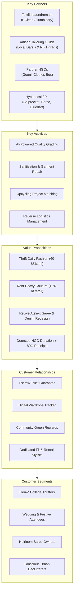

# REVIVE THREADS — EXECUTIVE SUMMARY & BUSINESS MODEL CANVAS

---

## 1. Executive Summary

### 1.1 The Context & Problem
India's retail apparel market exceeds **\$100 Billion**, fueled by rapid urbanization and the proliferation of low-cost fast fashion (e.g., Zara, H&M, Urbanic, Meesho). However, this consumption explosion has triggered severe structural frictions:
1. **Wardrobe Inefficiency & Landfill Pressure**: Over **1 million tonnes of textile waste** is generated annually in India. The average urban consumer wears only 20% of their wardrobe regularly.
2. **Occasion Wear Debt**: High-ticket ceremonial garments (bridal lehengas, sherwanis, designer saris costing ₹25,000–₹1,50,000) are worn 1–2 times, suffering 90% capital depreciation in storage.
3. **Fragmented & Scam-Ridden Thrifting**: Gen-Z demand for vintage/thrift fashion has exploded on Instagram, but users face zero buyer protection, ghost sellers, erratic sizing, and poor sanitization.
4. **Untapped Upcycling Potential**: India has millions of vintage silk sarees and durable denims, yet lack an organized digital bridge to connect consumers with skilled master tailors (*darzis*) and upcycling designers.
5. **Friction in Clothes Donation**: Traditional donation requires manual drop-offs, lacks verification, and provides no transparency on where clothes end up.

### 1.2 The Solution: Revive Threads
**Revive Threads** is India's first omnichannel circular fashion platform. We provide an integrated, trustworthy, four-pillar infrastructure:
- **Thrift (Re-Wear)**: Peer-to-peer and managed resale for everyday apparel (daily tops, shirts, skirts, dresses, blazers) with escrow payment and 5-point quality assurance.
- **Rent (Re-Live)**: Insured, dry-cleaned rentals for heavy festive and wedding couture at 10–15% of retail price.
- **Revive Atelier (Re-Invent)**: On-demand upcycling studio connecting consumers with vetted pattern-makers and tailors to redesign heirlooms (e.g., Mom's vintage Kanjeevaram into a modern blazer or corset dress; distressed jeans into tote bags).
- **Donate (Re-Give)**: Doorstep charity pickups partnered with verified NGOs (Goonj, Clothes Box Foundation) yielding instant 80G tax receipts and platform green reward credits.

---

## 2. Lean Canvas

| Canvas Block | Details & Strategic Implementation |
| :--- | :--- |
| **1. Problem** | • Fast fashion waste & micro-trend exhaustion. • Heavy festive apparel worn once, locking up billions in dead capital. • Unregulated Instagram thrifting (counterfeits, no returns, no sanitization). • Zero accessible digital infrastructure to upcycle heritage textiles. • Friction in donating wearable clothes to legitimate charities. |
| **2. Customer Segments** | • **Gen Z & College Students (18–24)**: Value-driven, eco-conscious, trendy daily thrifting. • **Young Professionals & Wedding Attendees (24–35)**: Renting heavy occasion wear, rotating workwear blazers. • **Heirloom Keepers & Mothers (30–55)**: Saree upcycling, redesigning family textiles. • **Eco-Conscious Donors**: Streamlined doorstep decluttering. |
| **3. Unique Value Proposition** | *"India's unified wardrobe lifecycle platform: Shop pre-loved daily wear, rent festive grandeur, redesign heirloom fabrics, or donate with purpose—all under verified quality assurance."* |
| **4. Solution** | • Verified P2P & Consignment Thrift Marketplace with escrow protection. • Smart rental engine with automated calendar, dry-cleaning & security escrow. • Revive Atelier: Saree-to-silhouette upcycling configurator & tailor matchmaking. • 1-Click NGO Pickup with digital impact receipts & green thread credits. |
| **5. Unfair Advantage** | • **Proprietary Reverse Logistics & QC Network**: Partnerships with tier-1 dry cleaning chains (UClean, Tumbledry) for automated inspection and medical-grade sanitization. • **Artisan Tailor Guild**: Exclusive network of 300+ vetted master pattern-makers for precision upcycling. • **Closed-Loop Flywheel**: Every rejected thrift listing automatically flows into upcycling scrap or donation, ensuring zero platform waste. |
| **6. Revenue Streams** | • **Thrift Commission**: 15% marketplace take-rate + ₹49 buyer protection fee. • **Rental Consignment Split**: 35% platform share on rental GMV + dry-cleaning fee. • **Upcycling Studio Cut**: 20% platform fee on custom tailor orders. • **B2B Brand Clearance & CSR Sponsorships**: Eco-tagging & NGO corporate partner fees. • **Revive Premium Subscription**: ₹299/quarter for free shipping & priority rental slots. |
| **7. Cost Structure** | • Reverse logistics & doorstep pickup shipping contracts (Shiprocket / Bluedart). • Professional eco-laundering & sanitization per rental. • Tech infrastructure, cloud hosting (AWS), AI visual search & valuation algorithms. • Artisan & tailor onboarding, payout escrow reserves. • Customer Acquisition Cost (CAC) via influencer thrifting hauls & campus ambassadors. |
| **8. Key Metrics (KPIs)** | • **North Star**: Circular GMV (₹) & Kilograms of Textile Diverted from Landfills. • Thrift Average Order Value (AOV): ₹1,250. • Rental AOV: ₹3,800. • Monthly Active Wardrobes (MAW). • LTV / CAC Ratio (Target: > 3.8x). • Return & Dispute Rate (< 3.5%). |
| **9. Channels** | • Campus Brand Ambassador Programs (DU, Mumbai Univ, NIFT, Christ). • Instagram Reels & "Thrift Haul / Saree Flip" Viral Content. • Wedding Planner & Makeup Artist Referral Networks for Rentals. • Sustainable Fashion Pop-up Kiosks in Metro Malls (Phoenix Marketcity, DLF). |

---

## 3. The 9-Block Business Model Canvas (BMC)

---

## 4. The Revive Circular Flywheel

1. **Acquisition via Daily Thrifting**: College students and young urbanites join to buy and sell trending tops, skirts, and blazers at budget prices.
2. **Monetization & GMV Acceleration via Rental**: As users attend weddings, festives, and convocations, they rent high-ticket lehengas and suits rather than buying fast-fashion duplicates.
3. **Sentiment & Retention via Revive Atelier**: Users who treasure old family sarees or vintage garments use our upcycling studio to craft contemporary silhouettes, building an emotional, irreplaceable brand bond.
4. **Full Circle via NGO Donation**: Clothes that fail thrift quality control or are too worn are seamlessly routed to verified charity distribution or textile recycling partners, creating a **100% Zero-Landfill Guarantee**.
