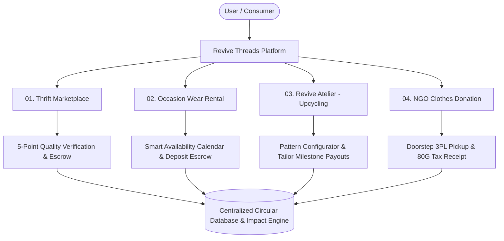
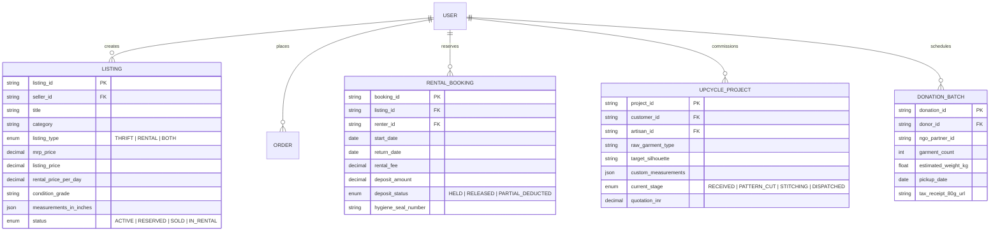

# REVIVE THREADS — PRODUCT REQUIREMENTS DOCUMENT (PRD)

| Document Details | Information |
| :--- | :--- |
| **Product Name** | Revive Threads Web & Mobile Platform |
| **Document Version** | 2.4 (Production Release Spec) |
| **Author** | Product Management Lead |
| **Status** | Approved / In Development |
| **Target Audience** | Urban Indian Conscious Consumers, Gen-Z Fashion Enthusiasts, Wedding Attendees, Tailors, Partner NGOs |

---

## 1. Product Vision & Strategic Objectives

### 1.1 Product Vision
To build the most trusted, frictionless, and joyful circular fashion ecosystem in India—empowering any user to buy, sell, rent, upcycle, or donate clothing with total transparency, quality verification, and positive planetary impact.

### 1.2 Key Objectives (OKRs)
- **Objective 1 (Marketplace Liquidity)**: Achieve 70% sell-through rate for thrift listings within 21 days of posting.
- **Objective 2 (Trust & Hygiene)**: Reduce rental return disputes to under 2.5% through mandatory 5-point sanitization certification.
- **Objective 3 (Atelier Innovation)**: Enable end-to-end digital upcycle ordering with 95% measurement and fit satisfaction.
- **Objective 4 (Planet Impact)**: Save 100,000 liters of freshwater and 5,000 kg of CO2 equivalent per 1,000 platform transactions.

---

## 2. User Personas

### Persona 1: Ananya Sen (21) — "The Fast-Fashion Thrift Hunter"
- **Demographics**: Final-year undergraduate, Delhi University. Monthly fashion budget: ₹2,500–₹4,000.
- **Behaviors**: Loves styling Pinterest-aesthetic outfits, shops on Instagram thrift pages, buys tops, skirts, oversized blazers, and dresses.
- **Pain Points**: Got scammed twice on Instagram (sent money via UPI, seller blocked her; another time received stained jeans with no return policy).
- **Needs on Revive Threads**: Escrow protection, accurate size measurements (bust, waist, length in inches), real condition tags, affordable shipping.

### Persona 2: Pooja Krishnan (28) — "The Wedding Guest & Occasion Wear Renter"
- **Demographics**: Marketing Manager at a Bengaluru tech firm. Attends 4–6 weddings and festive functions every winter.
- **Behaviors**: Spends ₹25,000 on lehengas that she only wears once because they get photographed and posted online.
- **Pain Points**: Wardrobe has 6 heavy lehengas collecting dust. Hates the hassle of storing and dry-cleaning them.
- **Needs on Revive Threads**: Rent high-end designer lehengas and festive outfits for 3–7 days at ₹2,500–₹4,500 with included dry-cleaning and a simple return courier bag. Also wants to list her own lehengas on rental consignment.

### Persona 3: Meera Deshmukh (46) — "The Heritage Saree Custodian"
- **Demographics**: Homemaker & Mother, Pune.
- **Behaviors**: Inherited 30+ pure silk Kanjeevaram and Paithani sarees from her mother and grandmother.
- **Pain Points**: Her daughters don't drape heavy sarees regularly, but the emotional value prevents her from selling them.
- **Needs on Revive Threads**: Revive Atelier—a safe platform to send a vintage saree and have it refashioned into a modern embroidered jacket, festive co-ord set, or lehenga skirt with a verified master tailor.

### Persona 4: Master Rafiq (44) — "The Revive Atelier Artisan Partner"
- **Demographics**: Master Tailor with 22 years of experience in Old Delhi.
- **Pain Points**: Offline alteration business is seasonal and irregular; lacks digital marketing to reach young design-oriented clients.
- **Needs on Revive Threads**: Standardized cutting patterns, steady digital order flow, clear customer measurements, and guaranteed milestone payouts directly into his bank account.

---

## 3. Product Architecture & Modules

---

## 4. Epic & Feature Specifications

### Epic 1: Unified Multi-Category Discovery & Catalog
- **Story 1.1 (Multi-Mode Navigation)**:
  - Users can toggle between **Daily Thrift**, **Occasion Rental**, **Upcycle Studio**, and **Donate** from the primary navigation bar.
- **Story 1.2 (Daily Wear Categories)**:
  - Supports: Tops & Blouses, Skirts, Dresses, Linen & Casual Shirts, Blazers & Outerwear, Trousers & Denim.
- **Story 1.3 (Occasion Wear Categories)**:
  - Supports: Bridal & Wedding Lehengas, Festive Anarkalis, Sherwanis, Cocktail Gowns, Designer Tuxedos.
- **Story 1.4 (Condition & Eco Badges)**:
  - Every listing clearly displays:
    - *Condition Tag*: "Brand New with Tags", "Pristine / Like New", "Gently Loved".
    - *Savings Indicator*: Original MRP vs. Thrift/Rental Price (% discount).
    - *Planetary Metric*: "Saved ~2,700L water" or "Offset 4.2kg CO2".

### Epic 2: Intelligent P2P Seller Listing Wizard
- **Story 2.1 (Multi-Step Listing Flow)**:
  - Step 1: Upload 4–6 clear photos (Front, Back, Label, Close-up of fabric/defects).
  - Step 2: Auto-detect brand, fabric, and color using visual tagging suggestions.
  - Step 3: Exact physical measurements entry (Bust, Waist, Hip, Full Length in inches).
  - Step 4: Condition checklist (Any tears? Missing buttons? Fading? Odor?).
  - Step 5: Dual-Mode Listing Choice: List for **Direct Sale (Thrift)**, **Rental (Occasion)**, or **Both**.
- **Story 2.2 (AI Dynamic Price Recommender)**:
  - Suggests optimal listing price based on brand tier, garment age, and condition to ensure sale within 14 days.

### Epic 3: Occasion Wear Rental Engine
- **Story 3.1 (Date Picker & Duration Selection)**:
  - 3-Day Event Window (Deliver 1 day prior, Event day, Pickup next day).
  - 7-Day Festival Window for destination weddings.
- **Story 3.2 (Refundable Security Deposit & Insurance)**:
  - Standard deposit (typically 30–50% of rental fee) held in escrow.
  - Optional ₹149 "Worry-Free Stain Shield" covers minor spills, makeup smudges, and loose sequins without deposit deduction.
- **Story 3.3 (Sanitization & QC Seal)**:
  - Every garment arrives in a sealed garment bag with a numbered sanitation tag signed by the dry-clean partner.

### Epic 4: Revive Atelier — The Upcycling Hub
- **Story 4.1 (Textile Upload & Silhouette Selection)**:
  - Customer uploads photos and specifies fabric type (e.g., Pure Kanjeevaram Silk, Banarasi Brocade, Vintage Denim Jeans, Chanderi Cotton).
  - Selects target upcycled silhouette:
    - *Option A*: Vintage Saree $\rightarrow$ Tailored Crop Blazer & Trousers Set.
    - *Option B*: Vintage Saree $\rightarrow$ Pre-Stitched Festive Anarkali / Lehenga Skirt.
    - *Option C*: Old Denim Jeans $\rightarrow$ Patchwork Denim Tote Bag or Structured Corset.
    - *Option D*: Custom Bespoke Brief.
- **Story 4.2 (Measurement & Tailor Matching)**:
  - User submits body measurements using our visual guide.
  - Revive Threads matches the order to a certified Master Tailor based on fabric specialty.
- **Story 4.3 (Milestone Tracking & Approval)**:
  - Stage 1: Saree received at atelier & inspected.
  - Stage 2: Pattern cutting approved via photo preview.
  - Stage 3: Stitching completed & trial fit dispatched.

### Epic 5: NGO Clothes Donation & Tax Benefit Portal
- **Story 5.1 (Doorstep Pickup Scheduling)**:
  - User specifies number of bags/garments and preferred pickup slot.
- **Story 5.2 (Partner NGO Allocation)**:
  - Users choose their preferred cause:
    - *Goonj (Rural livelihood & relief kits)*.
    - *Clothes Box Foundation (Shelters & winter warmth)*.
    - *Local Animal Shelters (Old towels & shredded denim for animal bedding)*.
- **Story 5.3 (80G Tax Exemption & Green Credits)**:
  - Automated digital 80G tax receipt issued upon NGO verification.
  - User earns 100 "Green Threads" loyalty points per kilogram donated, redeemable for discounts on thrift and rental orders.

---

## 5. Technical Data Models (Core Entities)

---

## 6. Reverse Logistics & The 5-Point Quality Control Pipeline

1. **Step 1: Fabric Integrity Check**: Inspection under high-lux lamps for unseen tears, pilling, fabric thinning, or seam unraveling.
2. **Step 2: Stain & Discoloration Scan**: High-frequency UV inspection for organic stains, deodorant marks, and color fading.
3. **Step 3: Hardware & Trim Verification**: Ensuring all zippers glide smoothly, buttons are tight, hook-and-eye closures are intact, and embellishments are secured.
4. **Step 4: Dimension Calibration**: Physical tape measurement verified against seller's submitted sizing chart to ensure true-to-fit delivery.
5. **Step 5: Eco-Medical Steam Sanitization**: Industrial steam pressing at $110^\circ\text{C}$ with organic essential oil infusion (neem and lavender extracts), sealed in compostable tamper-evident garment wrap with inspection barcode.
