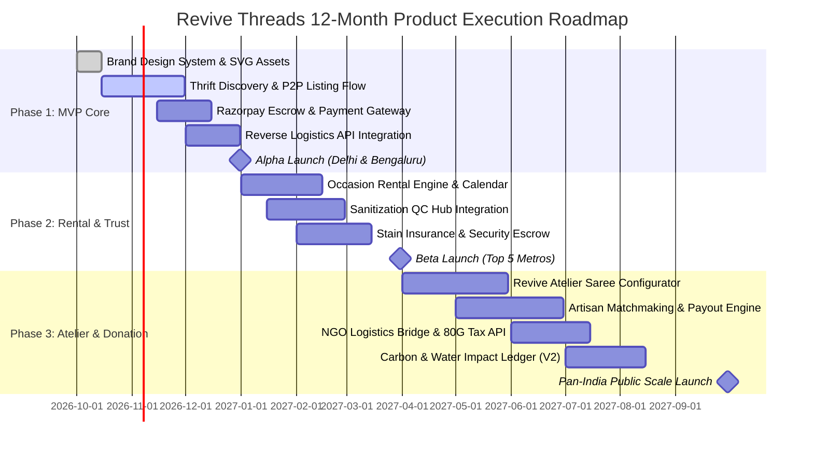

# REVIVE THREADS — PROJECT MANAGEMENT ROADMAP, RICE MATRIX & RISK REGISTER

---

## 1. Feature Prioritization: The RICE Scoring Framework

The RICE framework (**R**each $\times$ **I**mpact $\times$ **C**onfidence $\div$ **E**ffort) is used to prioritize the roadmap backlog.

- **Reach (R)**: Number of users impacted per quarter (in thousands).
- **Impact (I)**: 0.25 (Minimal), 0.5 (Low), 1.0 (Medium), 2.0 (High), 3.0 (Massive game-changer).
- **Confidence (C)**: 50% (Moonshot), 80% (Moderate evidence), 100% (High validation).
- **Effort (E)**: Person-months of engineering/design work.

$$\text{RICE Score} = \frac{\text{Reach} \times \text{Impact} \times \text{Confidence}}{\text{Effort}}$$

| Feature / Initiative | Pillar | Reach (k/qtr) | Impact | Conf. (%) | Effort (mo) | RICE Score | Priority |
| :--- | :--- | :--- | :--- | :--- | :--- | :--- | :--- |
| **Instant AI Price Estimator & Smart Listing** | Thrift | 85 | 2.0 | 90% | 1.5 | **102.0** | **P0 (Sprint 1-2)** |
| **Rental Escrow & Stain Insurance Shield** | Rental | 45 | 3.0 | 85% | 1.8 | **63.8** | **P0 (Sprint 2-3)** |
| **Revive Atelier: Saree-to-Silhouette Configurator** | Upcycle | 30 | 3.0 | 80% | 2.0 | **36.0** | **P0 (Sprint 4-5)** |
| **Doorstep 1-Click NGO Pickup & 80G Tax Generator** | Donate | 40 | 1.5 | 90% | 1.2 | **45.0** | **P1 (Sprint 3-4)** |
| **5-Point Physical QC & Steam Sanitization Portal** | Ops/Trust | 60 | 2.5 | 95% | 2.2 | **64.8** | **P0 (Sprint 2-3)** |
| **Dynamic Water & Carbon Footprint Counter** | Impact | 95 | 1.0 | 100% | 0.8 | **118.8** | **P0 (Sprint 1)** |
| **In-App Messaging & Seller Counter-Offer Chat** | Thrift | 65 | 1.5 | 85% | 1.5 | **55.3** | **P1 (Sprint 4)** |
| **Bridal Rental Try-at-Home Vanity Box** | Rental | 15 | 2.5 | 70% | 2.5 | **10.5** | **P2 (Phase 2)** |
| **Denim-to-Accessories Upcycling Pre-sets** | Upcycle | 25 | 1.5 | 85% | 1.0 | **31.9** | **P1 (Sprint 5)** |
| **"Green Thread" Gamified Loyalty Rewards Club** | Growth | 80 | 1.5 | 80% | 1.2 | **80.0** | **P1 (Sprint 3)** |

---

## 2. 12-Month Phased Engineering & Launch Roadmap

---

## 3. Risk Management & Mitigation Register

| Risk ID | Category | Description | Likelihood | Impact | Severity Score (L x I) | Mitigation Strategy | Owner |
| :--- | :--- | :--- | :--- | :--- | :--- | :--- | :--- |
| **RSK-01** | Operations | **Rental Garment Damage or Severe Staining** | Medium (3) | High (4) | **12 (High)** | Mandatory ₹149 stain shield; ₹2,000 refundable security deposit held in escrow; contract with specialized dry-clean restorers. | Head of Ops |
| **RSK-02** | Trust | **Counterfeit or Falsely Described Thrift Items** | Medium (3) | High (4) | **12 (High)** | Mandatory photo angles of serial tags/seams; 48-hour buyer verification window before seller funds are released from escrow. | Lead PM |
| **RSK-03** | Logistics | **Reverse Logistics Delays during Peak Wedding Season** | High (4) | High (4) | **16 (Critical)** | Multi-carrier routing (Bluedart, Delhivery, Borzo for same-day metro delivery); 48h buffer built into rental dispatch dates. | Logistics Lead |
| **RSK-04** | Product | **Fit Discrepancies in Upcycled Custom Garments** | Medium (3) | Medium (3) | **9 (Medium)** | 3D visual measurement guide with video validation; master tailor test swatch protocol; 1 free doorstep alteration within 7 days. | Atelier PM |
| **RSK-05** | Legal/Tax | **NGO Donation Compliance & 80G Verification** | Low (2) | Medium (3) | **6 (Low)** | Direct API integration with FCRA/80G certified partner foundations (Goonj, Clothes Box); digital automated receipt generation. | Legal Counsel |

---

## 4. Stakeholder RACI Matrix

- **R**esponsible: Does the work.
- **A**ccountable: Final decision-maker / sign-off.
- **C**onsulted: Provides domain input.
- **I**nformed: Kept updated on progress.

| Deliverable / Workstream | Product Manager | Tech Lead / Eng | UX/UI Designer | Ops / QC Lead | Growth / Marketing |
| :--- | :--- | :--- | :--- | :--- | :--- |
| **Brand Identity & Style Guide** | C | I | **A / R** | I | C |
| **PRD & User Story Definition** | **A / R** | C | C | C | I |
| **Web & Mobile Front-End Architecture** | I | **A / R** | C | I | I |
| **Reverse Logistics & Hub QC Protocol** | C | I | I | **A / R** | I |
| **Atelier Master Tailor Onboarding** | C | I | I | **A / R** | C |
| **Financial Unit Economics & Investor Deck** | **A / R** | I | I | C | C |
| **Campus Ambassador & Influencer Launch**| I | I | I | I | **A / R** |
